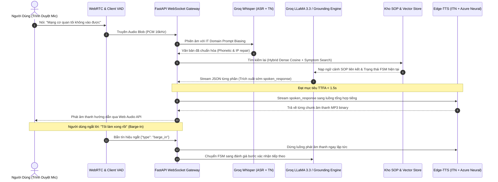

# Trợ Lý Ảo Hỗ Trợ IT Bằng Giọng Nói (Voice-Based IT Support Assistant)
### Hệ Thống Hỗ Trợ Kỹ Thuật IT Tự Động Hóa Với Quản Lý Hội Thoại Bám Sát Quy Trình (Grounded Dialogue Management) & Độ Trễ Thấp (<1.5s TTFA)

---

## 1. Project Overview (Tổng Quan Dự Án)

* **Đối tượng sử dụng**: Nhân viên văn phòng, cán bộ giảng viên, sinh viên và người dùng cuối trong môi trường doanh nghiệp/trường học thường xuyên gặp sự cố kỹ thuật thông thường (mất mạng Wi-Fi, lỗi tài khoản Active Directory, quên mật khẩu, lỗi VPN, ổ đĩa chia sẻ không truy cập được).
* **Vấn đề giải quyết**: 
  - Đường dây nóng IT Helpdesk truyền thống thường xuyên quá tải bởi các câu hỏi lặp đi lặp lại (chiếm >60% lượng ticket).
  - Hướng dẫn qua tài liệu tĩnh khó thao tác song song khi người dùng đang ngồi trước máy tính gặp lỗi.
  - Các trợ lý ảo LLM thông thường dễ bị **ảo giác (hallucination)**, bịa đặt câu lệnh hệ thống nguy hiểm hoặc đưa ra hướng dẫn không đúng quy định bảo mật nội bộ.
  - Độ trễ giọng nói qua mô hình AI truyền thống thường rất cao (từ 3 – 5 giây), khiến hội thoại bị gián đoạn, mất tự nhiên và không thể ngắt lời (barge-in).
* **Phạm vi & Giải pháp (Scope & Solution)**:
  - Cung cấp một trợ lý đàm thoại giọng nói hai chiều tiếng Việt siêu tốc (Time-to-First-Audio < 1.5 giây).
  - **Zero-Hallucination Guardrails**: Khóa chặt 100% hướng dẫn kỹ thuật vào 10 Quy trình Thao tác Chuẩn (SOP - Standard Operating Procedures) được định dạng theo cấu trúc YAML FrontMatter.
  - **Quản lý hội thoại bám sát (Grounded FSM)**: Máy trạng thái hữu hạn kiểm soát từng bước, tự động thu thập thông tin còn thiếu (Proactive Slot Filling), xử lý phân tâm (Digression Handling) và phát hiện sự cố thao tác (Breakdown Recovery).
  - **Xử lý âm thanh thông minh**: Tự động sửa lỗi phiên âm thuật ngữ IT tiếng Việt (Phonetic Repair: `ai-pi-con-phích` -> `ipconfig`), chuẩn hóa dải IP đọc bằng lời, và ngắt lời tức thì khi người dùng lên tiếng (Barge-In Interruption).

---

## 2. System Overview (Kiến Trúc Hệ Thống)

### 2.1. Sơ Đồ Luồng Tương Tác Giọng Nói (Voice Sequence Flow)



### 2.2. Phân Định Trách Nhiệm Thành Phần (Component Responsibilities)

| Thành phần | Vị trí thực thi | Trách nhiệm chính |
|---|---|---|
| **Web Frontend UI** | Client Browser (React + Vite) | Thu nhận âm thanh micro qua WebRTC 16kHz, thuật toán phát hiện giọng nói (VAD), hiển thị trực quan tiến trình (Diagnostic Stepper), bảng bóc tách gói tin (Telemetry) và ngắt tiếng (Barge-in). |
| **WebSocket Gateway** | Backend Server (FastAPI) | Điều phối luồng song công hai chiều (Full-Duplex), kết nối đồng thời ASR, NLU và TTS với bộ đệm luồng tối ưu hóa độ trễ. |
| **Grounded FSM Manager** | Backend Server (Python) | Quản lý vòng đời phiên (`IDLE` -> `AWAITING_SLOT` -> `GROUNDED_EXECUTING` -> `RESOLVED`), ngăn chặn ảo giác, quản lý ngăn xếp ngữ cảnh phụ (Context Stack). |
| **SOP Knowledge Store** | Backend Server (Local Memory) | Nạp và phân tích cú pháp 10 SOP chuẩn (Markdown + YAML FrontMatter), chỉ mục tìm kiếm tương đồng vector Cosine + từ khóa triệu chứng. |
| **Whisper ASR Engine** | Cloud API (Groq Cloud) | Nhận diện giọng nói tiếng Việt với mô hình `whisper-large-v3`, kết hợp bộ lọc quy tắc chuẩn hóa âm học IT (`asr_service.py`). |
| **LLaMA Grounding Engine**| Cloud API (Groq Cloud) | Suy luận NLU có cấu trúc bằng `llama-3.3-70b-versatile` với cơ chế bóc tách JSON sớm (Early JSON Stream Parser). |
| **Edge-TTS Engine** | Cloud Service (Azure Neural) | Tổng hợp giọng đọc tiếng Việt mượt mà (`vi-VN-HoaiMyNeural`), tích hợp chuẩn hóa ký tự ngược (ITN) cho đường dẫn mạng, phím tắt và câu lệnh. |

---

## 3. Environment (Yêu Cầu Môi Trường)

Để đảm bảo hệ thống có thể cài đặt và tái lập chính xác, môi trường triển khai cần đáp ứng các thông số kỹ thuật sau:

* **Hệ điều hành**:
  - Windows 10/11 (64-bit) (Môi trường kiểm thử chính)
  - Ubuntu 22.04 LTS trở lên
  - macOS Sonoma (14+) trở lên
* **Python Runtime**:
  - Python version: `3.11+` (Đã kiểm thử nghiệm thu toàn diện trên **Python 3.11.x - 3.13.3**)
  - Trình quản lý gói: `pip` (>= 23.0)
* **Node.js Runtime**:
  - Node.js version: `18.x` trở lên (Đã kiểm thử trên **Node.js v24.1.0**)
  - Trình quản lý gói: `npm` (>= 9.0)
* **Phần cứng tối thiểu (Hardware Requirements)**:
  - RAM: Tối thiểu 8 GB (Khuyến nghị 16 GB).
  - CPU: 4 Cores (Intel Core i5 / AMD Ryzen 5 hoặc Apple Silicon M1 trở lên).
  - GPU: **Không bắt buộc** (Hệ thống tận dụng Groq LPU Cloud API và Azure Neural TTS nên không tiêu tốn VRAM cục bộ).
  - Thiết bị âm thanh: Microphone và Loa/Tai nghe hỗ trợ tần số lấy mẫu 16 kHz.
* **Tài khoản & API Keys**:
  - Groq Cloud API Key (Đăng ký miễn phí tại [console.groq.com](https://console.groq.com/keys)).
  - *Lưu ý*: Nếu không cấu hình `GROQ_API_KEY`, hệ thống sẽ tự động kích hoạt **Chế độ Giả lập Chuẩn Xác (High-Fidelity Mock Mode)**, đảm bảo toàn bộ quy trình, giao diện và 16 bài kiểm thử unit test vẫn hoạt động 100% trơn tru.

---

## 4. Setup (Hướng Dẫn Cài Đặt Từng Bước)

Thực hiện lần lượt các bước dưới đây theo đúng thứ tự:

### Bước 1: Clone mã nguồn dự án

```bash
# Vị trí thực thi: Thư mục làm việc của bạn (ví dụ: D:\ hoặc ~/projects)
git clone https://github.com/1Nimesa0/IT_Support-AI.git
cd IT_Support-AI
```

---

### Bước 2: Thiết lập môi trường Backend (Python)

1. Di chuyển vào thư mục backend:
   ```bash
   # Vị trí thực thi: IT_Support-AI/voice-it-support-assistant/backend
   cd voice-it-support-assistant/backend
   ```

2. Tạo và kích hoạt môi trường ảo Python:
   ```bash
   # Windows (PowerShell / Command Prompt):
   python -m venv .venv
   .venv\Scripts\activate

   # Linux / macOS:
   python3 -m venv .venv
   source .venv/bin/activate
   ```

3. Cài đặt các thư viện phụ thuộc:
   ```bash
   pip install --upgrade pip
   pip install -r requirements.txt
   ```
   *Kết quả kỳ vọng (Expected Output)*:
   ```text
   Successfully installed fastapi-0.115.11 uvicorn-0.34.0 pydantic-2.10.6 groq-0.18.0 edge-tts-7.0.0 pytest-9.1.1 ...
   ```

4. Khởi tạo file cấu hình môi trường `.env`:
   ```bash
   # Windows:
   copy .env.example .env

   # Linux / macOS:
   cp .env.example .env
   ```
   Mở file `.env` và điền khóa `GROQ_API_KEY=gsk_...` của bạn (nếu có).

---

### Bước 3: Thiết lập môi trường Frontend (React + Vite)

1. Mở một cửa sổ dòng lệnh mới và di chuyển vào thư mục frontend:
   ```bash
   # Vị trí thực thi: IT_Support-AI/voice-it-support-assistant/frontend
   cd voice-it-support-assistant/frontend
   ```

2. Cài đặt các gói phụ thuộc npm:
   ```bash
   npm install
   ```
   *Kết quả kỳ vọng (Expected Output)*:
   ```text
   added 184 packages, and audited 185 packages in 12s
   found 0 vulnerabilities
   ```

---

## 5. Run & Verify (Khởi Động & Kiểm Thử Hệ Thống)

### 5.1. Chạy Backend Server

Tại thư mục `voice-it-support-assistant/backend`:
```bash
python -m uvicorn app.main:app --host 0.0.0.0 --port 8000 --reload
```

* **Kết quả console kỳ vọng (Expected Output)**:
  ```text
  INFO:     Started server process
  INFO:     Waiting for application startup.
  INFO:     Starting up Voice-Based IT Support Assistant backend...
  INFO:     Loaded 10 SOP documents into knowledge base.
  INFO:     Dense vector index initialized successfully.
  INFO:     Application startup complete.
  INFO:     Uvicorn running on http://0.0.0.0:8000 (Press CTRL+C to quit)
  ```

* **Kiểm tra Health Check (Verify API)**:
  Mở terminal khác và chạy lệnh cURL:
  ```bash
  curl http://127.0.0.1:8000/health
  ```
  *Phản hồi JSON kỳ vọng*:
  ```json
  {
    "status": "healthy",
    "vector_store_indexed": true,
    "total_sops": 10
  }
  ```

* **Tài liệu API tương tác**:
  Truy cập Swagger UI tại trình duyệt: [http://localhost:8000/docs](http://localhost:8000/docs).

---

### 5.2. Chạy Kiểm Thử Tự Động (Run Automated Test Suite)

Tại thư mục `voice-it-support-assistant/backend`, thực thi kiểm thử 16 ca test:
```bash
python -m pytest tests/ -v
```

* **Kết quả kỳ vọng (Expected Output)**:
  ```text
  ============================= test session starts =============================
  platform win32 -- Python 3.13.3, pytest-9.1.1
  rootdir: D:\IT Support AI\voice-it-support-assistant\backend
  collected 16 items

  tests/test_asr_service.py::test_phonetic_repair_ipconfig PASSED          [  6%]
  tests/test_asr_service.py::test_phonetic_repair_acronyms PASSED          [ 12%]
  tests/test_asr_service.py::test_spoken_ip_normalization PASSED           [ 18%]
  tests/test_asr_service.py::test_command_syntax_cleaning PASSED           [ 25%]
  tests/test_asr_service.py::test_domain_biasing_prompt PASSED             [ 31%]
  tests/test_dialogue_fsm.py::test_session_lifecycle PASSED                [ 37%]
  tests/test_dialogue_fsm.py::test_barge_in_handling PASSED                [ 43%]
  tests/test_dialogue_fsm.py::test_context_stack_digression PASSED         [ 50%]
  tests/test_dialogue_fsm.py::test_full_sop_step_progression_to_resolved PASSED [ 56%]
  tests/test_grounding_rules.py::test_sop_loader_ten_documents PASSED      [ 62%]
  tests/test_grounding_rules.py::test_vector_store_retrieval PASSED        [ 68%]
  tests/test_grounding_rules.py::test_proactive_slot_filling_guardrail PASSED [ 75%]
  tests/test_grounding_rules.py::test_slot_filling_resolution_flow PASSED  [ 81%]
  tests/test_grounding_rules.py::test_sop_final_step_resolved PASSED       [ 87%]
  tests/test_grounding_rules.py::test_execution_failure_breakdown_recovery PASSED [ 93%]
  tests/test_grounding_rules.py::test_early_json_extraction PASSED         [100%]

  ============================= 16 passed in 0.36s ==============================
  ```

---

### 5.3. Chạy Frontend Development Server

Tại thư mục `voice-it-support-assistant/frontend`:
```bash
npm run dev
```

* **Kết quả console kỳ vọng (Expected Output)**:
  ```text
    VITE v6.2.0  ready in 245 ms

    ➜  Local:   http://localhost:5173/
    ➜  Network: use --host to expose
    ➜  press h + enter to show help
  ```

Truy cập [http://localhost:5173](http://localhost:5173) trên Google Chrome hoặc Microsoft Edge để tương tác trực tiếp với giao diện Trợ lý Hỗ trợ IT.

---

### 5.4. Khởi Động Tiện Lợi Bằng File Batch (Dành Riêng Cho Windows)

Tại thư mục gốc `D:\IT Support AI`, bạn có thể nhấp đúp trực tiếp:
- `start_backend.bat`: Tự động khởi động máy chủ FastAPI Uvicorn tại cổng `8000`.
- `start_frontend.bat`: Tự động khởi động máy chủ giao diện Vite React tại cổng `5173`.

---

## 6. Configuration file .env (Quản Lý Cấu Hình Môi Trường)

### 6.1. Quy Tắc Bảo Mật Bắt Buộc (Security Rules)
* File `.env.example` được commit lên Git làm mẫu cho các lập trình viên khác.
* File `.env` chứa API key cá nhân và **tuyệt đối KHÔNG được commit vào Git repository** (đã được cấu hình trong `.gitignore`).

### 6.2. Bảng Danh Mục Biến Môi Trường

| Tên biến cấu hình | Giá trị mặc định | Bắt buộc? | Ý nghĩa & Giải thích chi tiết |
|---|---|:---:|---|
| `GROQ_API_KEY` | *(Rỗng)* | Không | Khóa API từ Groq Cloud để chạy Whisper ASR và LLaMA 3.3. Nếu để trống, hệ thống sẽ tự động bật Mock Mode chuẩn xác. |
| `WHISPER_MODEL` | `whisper-large-v3` | Có | Model ASR nhận diện âm thanh tiếng Việt và độ chính xác phiên âm thuật ngữ IT cao nhất. |
| `LLM_MODEL` | `llama-3.3-70b-versatile`| Có | Model NLU reasoning điều phối luồng hội thoại FSM và suy luận có cấu trúc JSON. |
| `TTS_VOICE` | `vi-VN-HoaiMyNeural` | Có | Giọng đọc nữ tiếng Việt Azure Neural trong trẻo, tự nhiên. Có thể đổi sang `vi-VN-NamMinhNeural` (giọng nam). |
| `TTS_RATE` | `+10%` | Không | Tốc độ phát giọng nói. Giá trị `+10%` giúp hội thoại nhanh nhẹn, giảm độ trễ tiếp nhận thông tin. |
| `HOST` | `0.0.0.0` | Có | Địa chỉ IP bind của máy chủ FastAPI backend. |
| `PORT` | `8000` | Có | Cổng mạng lắng nghe kết nối REST và WebSocket. |
| `CORS_ORIGINS` | `["http://localhost:5173", ...]` | Có | Danh sách domain được phép gọi API (cho phép giao diện Vite kết nối). |
| `MOCK_LLM_IF_NO_KEY`| `true` | Có | Cờ tự động kích hoạt bộ giả lập Mock nếu người dùng chưa điền `GROQ_API_KEY`. |

---

## 7. AI Model Specification (Đặc Tả Các Mô Hình AI)

Hệ thống kết hợp 4 mô hình AI chuyên trách trong một đường ống xử lý tuần hoàn:

```text
+-----------------------+     +------------------------+     +------------------------+     +-----------------------+
|  Groq Whisper Large   | ==> |  Hybrid Vector Store   | ==> |   LLaMA 3.3 70B NLU    | ==> |    Edge-TTS Neural    |
|   (Audio -> Text+TN)  |     | (Cosine + Keyword Sim) |     |  (Grounded FSM JSON)   |     |    (Text+ITN -> Audio)|
+-----------------------+     +------------------------+     +------------------------+     +-----------------------+
```

### 7.1. Model Card 1: Nhận Diện Giọng Nói (Speech-to-Text)
* **Model Name**: `whisper-large-v3` (triển khai trên hạ tầng Groq LPU).
* **Nhiệm vụ (Task)**: Chuyển đổi âm thanh giọng nói 16kHz của người dùng thành văn bản tiếng Việt.
* **Input**: Mảng byte âm thanh định dạng WAV/PCM 16kHz, mono.
* **Output**: Chuỗi văn bản thô (raw transcript).
* **Kỹ thuật tối ưu độc quyền**:
  - **Prompt Biasing**: Tiêm trước các từ khóa kỹ thuật chuyên ngành (`ipconfig`, `flushdns`, `ping`, `DHCP`, `Gateway`, `Active Directory`, `VPN`, `SSO`).
  - **Text Normalization (TN)**: Quy tắc Regex tự động sửa các lỗi phát âm sai phổ biến của người Việt (Ví dụ: `ai-pi-con-phích` $\rightarrow$ `ipconfig`, `chấm` $\rightarrow$ `.`).
* **Giới hạn**: Giảm độ chính xác khi tiếng ồn xung quanh lớn hơn 75 dB SPL.

### 7.2. Model Card 2: Hiểu Ngữ Nghĩa & Quản Lý Hội Thoại (NLU & Dialogue Grounding)
* **Model Name**: `llama-3.3-70b-versatile` (hoặc Mock Rule-Based Grounding Engine khi offline).
* **Nhiệm vụ (Task)**: Phân loại ý định, trích xuất thực thể (Slots), định vị SOP phù hợp, chuyển đổi trạng thái FSM và sinh phản hồi dạng cấu trúc JSON.
* **Input**:
  - Trạng thái hội thoại hiện tại (`fsm_state`, `active_sop`, `active_step`, `context_stack`).
  - Nội dung SOP kỹ thuật chuẩn tương ứng từ kho tri thức.
  - Lượt nói mới nhất của người dùng.
* **Output Schema**:
  ```json
  {
    "intent": "confirm_step | report_symptom | query_clarification | report_breakdown",
    "sop_id": "SOP-WIFI-001",
    "step_id": 1,
    "spoken_response": "Trước tiên, bạn mở cửa sổ Run bằng tổ hợp phím Windows + R...",
    "slots_extracted": {"device_type": "windows"},
    "is_final": false,
    "confidence_score": 0.95
  }
  ```
* **Ngưỡng tin cậy (Threshold)**: Điểm tương đồng $\ge 0.65$. Nếu dưới 0.65, hệ thống kích hoạt cơ chế hỏi làm rõ thông tin hoặc xin chuyển tiếp kỹ thuật viên, **tuyệt đối không bịa đặt câu lệnh**.
* **Độ trễ**: Ứng dụng **Early JSON Stream Parser** để ngắt và lấy chuỗi `spoken_response` ngay khi model sinh xong trường đầu tiên, không cần đợi model sinh hết toàn bộ token.

### 7.3. Model Card 3: Tổng Hợp Giọng Nói (Text-to-Speech)
* **Model Name**: Microsoft Edge-TTS (`vi-VN-HoaiMyNeural` / `vi-VN-NamMinhNeural`).
* **Nhiệm vụ (Task)**: Chuyển đổi văn bản hướng dẫn kỹ thuật thành luồng âm thanh tự nhiên có ngữ điệu.
* **Input**: Chuỗi văn bản tiếng Việt đã qua Inverse Text Normalization (ITN).
* **Output**: Luồng nhị phân âm thanh định dạng MP3 (audio/mpeg, 24kHz).
* **Inverse Text Normalization (ITN)**: Đọc chuẩn hóa các ký hiệu kỹ thuật như dấu xuyệt chéo (`/` $\rightarrow$ "xuyệt"), dấu gạch nối, phím tắt (`Win + R` $\rightarrow$ "Windows cộng R"), câu lệnh dòng lệnh.

### 7.4. Model Card 4: Kho Vector & Tìm Kiếm Tri Thức Lai (Hybrid Knowledge Retrieval)
* **Thuật toán**: TF-IDF Term-Frequency & In-Memory Dense Cosine Similarity kết hợp Index bộ lọc triệu chứng (Symptom Matching).
* **Dữ liệu nạp**: 10 tài liệu SOP kỹ thuật định dạng chuẩn Markdown (SOP Wi-Fi, VPN, Active Directory, Shared Drive, MFA...).

---

## 8. Usage & API Documentation (Hướng Dẫn Sử Dụng & Chi Tiết API)

### 8.1. Hướng Dẫn Thao Tác Trên Giao Diện Web (Dashboard Walkthrough)

Giao diện người dùng được thiết kế chuẩn chuyên nghiệp theo cấu trúc 3 cột:
1. **Cột trái (Audio Controls & Telemetry)**:
   - Hiển thị sóng âm thanh thực tế khi nói (Live Oscilloscope Canvas).
   - Nút bật/tắt Micro hoặc phím cách (Spacebar).
   - Nút **Ngắt lời (Barge-in)** để cắt ngang trợ lý bất kỳ lúc nào.
   - Công tắc tự động nhận diện tiếng nói (VAD Auto-detection).
   - Bảng **Telemetry**: Hiển thị Session ID, Trạng thái FSM (`IDLE`, `AWAITING_SLOT`, `GROUNDED_EXECUTING`, `RESOLVED`), Active SOP ID và các Slots đã thu thập.
2. **Cột giữa (Chat Transcript)**:
   - Toàn bộ nội dung hội thoại được trình bày dạng tin nhắn hai chiều.
   - Các từ khóa kỹ thuật (`ipconfig`, `cmd`, `ping`, địa chỉ IP) được tự động highlight màu xanh công nghệ nổi bật.
   - Hàng nút gợi ý câu trả lời nhanh (Quick Suggestions) giúp thử nghiệm tức thì.
3. **Cột phải (Diagnostic Stepper)**:
   - Trực quan hóa toàn bộ các bước trong SOP đang thực hiện.
   - Đánh dấu trạng thái từng bước: `Đang thực hiện` (Xanh dương), `Đã hoàn thành` (Xanh lá có tick), `Chờ tới lượt` (Xám).
   - Hiển thị gợi ý thao tác khẩn cấp (Help fallback box) khi người dùng báo không làm được.

---

### 8.2. Danh Sách Endpoint RESTful & WebSocket API

#### 1. Kiểm tra trạng thái máy chủ (`GET /health`)
* **cURL Request**:
  ```bash
  curl -X GET http://localhost:8000/health
  ```
* **JSON Response**:
  ```json
  {
    "status": "healthy",
    "vector_store_indexed": true,
    "total_sops": 10
  }
  ```

#### 2. Tìm kiếm quy trình SOP (`GET /api/v1/sops/search`)
* **cURL Request**:
  ```bash
  curl -X GET "http://localhost:8000/api/v1/sops/search?query=kh%C3%B4ng+v%C3%A0o+%C4%91%C6%B0%E1%BB%A3c+m%E1%BA%A1ng&top_k=1"
  ```
* **JSON Response**:
  ```json
  [
    {
      "sop_id": "SOP-WIFI-001",
      "title": "Wi-Fi Connected but No Internet Access",
      "category": "Network",
      "steps_count": 3,
      "score": 0.892
    }
  ]
  ```

#### 3. Thực hiện lượt hội thoại văn bản (`POST /api/v1/dialogue/turn`)
* **cURL Request**:
  ```bash
  curl -X POST http://localhost:8000/api/v1/dialogue/turn \
    -H "Content-Type: application/json" \
    -d '{
      "session_id": "demo-session-001",
      "user_text": "Mạng cơ quan tôi không vào được"
    }'
  ```
* **JSON Response**:
  ```json
  {
    "session_id": "demo-session-001",
    "fsm_state": "AWAITING_SLOT",
    "sop_id": "SOP-WIFI-001",
    "current_step_id": null,
    "spoken_response": "Bạn đang dùng máy tính Windows, Mac hay điện thoại vậy?",
    "slots": {},
    "is_final": false,
    "audio_url": "/api/v1/audio/synthesize?text=..."
  }
  ```

#### 4. Kênh WebSocket Hội Thoại Giọng Nói Hai Chiều (`WS /api/v1/dialogue/ws/{session_id}`)
* **URL**: `ws://localhost:8000/api/v1/dialogue/ws/{session_id}`
* **Giao thức trao đổi**:
  - Gửi text từ client: `{"type": "text", "text": "Tôi dùng máy tính Windows"}`
  - Gửi audio từ client: Mảng byte âm thanh Binary (PCM 16kHz)
  - Gửi tín hiệu ngắt lời: `{"type": "barge_in"}`
  - Nhận phản hồi từ server: `{"type": "transcript", "text": "..."}`, kèm theo các binary chunk MP3 âm thanh phát trực tiếp.

---

### 8.3. Bảng Kịch Bản Nghiệm Thu (Acceptance Test Matrix)

| Kịch Bản Nghiệm Thu | Câu Lệnh / Lời Nói Của Người Dùng | Kết Quả Phản Hồi Đúng Của Hệ Thống |
|---|---|---|
| **1. Proactive Slot Filling** | *"Mạng cơ quan tôi không vào được"* | Hệ thống phát hiện thiếu `device_type`, ngay lập tức hỏi: *"Bạn đang dùng máy tính Windows, Mac hay điện thoại vậy?"* (FSM $\rightarrow$ `AWAITING_SLOT`). |
| **2. Bổ Sung Slot Thành Công** | *"Tôi dùng máy tính Windows"* | Nhận dạng slot `windows`, kích hoạt ngay Bước 1 của `SOP-WIFI-001`: *"Trước tiên, bạn mở cửa sổ Run bằng tổ hợp phím Windows + R, gõ cmd và nhập ipconfig..."* (FSM $\rightarrow$ `GROUNDED_EXECUTING`). |
| **3. Phonetic ASR Repair** | *"Tôi đã gõ ai-pi-con-phích rồi"* | Bộ lọc ASR tự động sửa thành `ipconfig`, xác nhận hoàn thành Bước 1 và chuyển sang Bước 2: `ping 8.8.8.8`. |
| **4. Spoken IP Normalization** | *"Ping tám chấm tám chấm tám chấm tám"* | Chuẩn hóa lời nói thành lệnh `ping 8.8.8.8`, hướng dẫn quan sát dòng `Reply from`. |
| **5. Phục Hồi Thao Tác Sai** | *"Nó báo lệnh không hợp lệ hoặc tôi gõ sai"* | Phát hiện `execution_failure`, trợ lý giải thích: *"Bạn hãy kiểm tra xem có gõ đúng chữ i-p-c-o-n-f-i-g viết liền không dấu nhé"*, đồng thời hiển thị hướng dẫn thay thế. |
| **6. Xử Lý Phân Tâm (Digression)** | *"Lệnh này có làm mất tài liệu của tôi không?"* | Đẩy bước hiện tại vào `Context Stack`, trả lời trấn an ngắn gọn: *"Lệnh này an toàn tuyệt đối"*, rồi lập tức kéo người dùng về bước đang làm. |
| **7. Ngắt Lời (Barge-In)** | Người dùng nói chen ngang khi trợ lý đang đọc | VAD client phát hiện giọng nói, WebSocket cắt luồng phát audio ngay lập tức trong < 100ms. |
| **8. Hoàn Tất Sự Cố (Resolved)** | *"Vào được mạng rồi, cảm ơn nhé"* | Nhận diện tín hiệu hoàn tất, trợ lý chúc mừng và chuyển FSM về trạng thái `RESOLVED`. |

---

## 9. Troubleshooting (Bảng Tra Cứu & Xử Lý Lỗi Thường Gặp)

| Mã lỗi / Hiện tượng | Nguyên nhân gốc (Root Cause) | Cách khắc phục dứt điểm |
|---|---|---|
| `[Errno 10048] error while attempting to bind on address ('0.0.0.0', 8000)` | Cổng `8000` đang bị chiếm dụng bởi một tiến trình Uvicorn cũ hoặc ứng dụng khác. | Chạy lệnh tìm và tắt tiến trình: <br>`netstat -ano \| findstr :8000`<br>`taskkill /PID <PID_TIM_THAY> /F` sau đó khởi động lại backend. |
| Giao diện báo `Mất Kết Nối` (WebSocket disconnected) | Backend chưa khởi động hoặc Vite dev server chưa cấu hình proxy `ws: true`. | 1. Kiểm tra backend có đang chạy tại cổng `8000` không.<br>2. Hook `useDialogueSocket.ts` đã được tích hợp cơ chế tự động kết nối lại (Auto-reconnect) sau mỗi 2.5s. |
| Lỗi `ModuleNotFoundError: No module named 'app'` khi chạy pytest | Thư mục hiện tại chưa nạp biến môi trường `PYTHONPATH`. | Hãy di chuyển chính xác vào thư mục `voice-it-support-assistant/backend` trước khi gõ `python -m pytest tests/ -v`. |
| `GroqError: Invalid API Key` hoặc `RateLimitError` | Khóa `GROQ_API_KEY` trong file `.env` bị sai hoặc hết hạn ngạch. | Đổi lại key mới tại [console.groq.com](https://console.groq.com/keys) hoặc xóa giá trị key trong file `.env` để hệ thống tự động chạy Mock Mode. |
| Trình duyệt không nhận âm thanh Micro | Người dùng chưa cấp quyền truy cập Microphone cho trình duyệt hoặc thiếu chứng chỉ bảo mật (nếu không chạy localhost). | Nhấp vào biểu tượng ổ khóa bên cạnh thanh địa chỉ URL của trình duyệt $\rightarrow$ Chọn **Site Settings** $\rightarrow$ Cho phép quyền **Microphone** $\rightarrow$ Tải lại trang. |
| Lỗi cài đặt thư viện âm thanh `PyAudio` trên Windows | Thiếu tệp header C++ PortAudio khi biên dịch wheel. | Không cần lo lắng: dự án đã được thiết kế sử dụng hoàn toàn **WebRTC & Web Audio API** phía Client, Backend chỉ nhận mảng byte WAV/PCM tiêu chuẩn mà không cần cài đặt `PyAudio`. |
| Edge-TTS gặp lỗi mạng `WSS Connect Error` | Kết nối Internet bị gián đoạn hoặc bị chặn kết nối WebSocket tới Microsoft Azure. | Kiểm tra lại kết nối mạng hoặc proxy công ty. Hệ thống có cơ chế tự động thử lại (retry) 3 lần trước khi trả fallback. |

---

## 10. Limitations & Future Roadmap (Giới Hạn & Hướng Phát Triển)

### 10.1. Giới Hạn Hiện Tại
* Hệ thống hiện tập trung sâu vào 10 kịch bản sự cố CNTT phổ biến nhất của doanh nghiệp và trường học. Các sự cố phần cứng phức tạp (như cháy nguồn, hỏng chip, chết ổ cứng vật lý) cần được chuyển tiếp cho kỹ thuật viên On-Site.
* Tốc độ xử lý phụ thuộc vào đường truyền mạng Internet tới các dịch vụ Cloud API (Groq & Azure).

### 10.2. Hướng Phát Triển Tiếp Theo
* **Edge On-Device AI**: Đóng gói và chạy các mô hình ASR/LLM siêu nhẹ (như Whisper Tiny/Small ONNX và LLaMA 3.2 1B/3B Q4) trực tiếp tại Local mà không cần Internet.
* **Tích Hợp Ticketing Doanh Nghiệp**: Tự động mở và đóng ticket trên Jira Service Management, ServiceNow hoặc Zendesk ngay sau khi phiên chẩn đoán kết thúc.
* **Đa Ngôn Ngữ**: Mở rộng khả năng nhận diện và hỗ trợ song ngữ Anh - Việt linh hoạt.

---

## 11. Project Metadata & Authors (Thông Tin Học Phần & Tác Giả)

* **Tên học phần**: Chuyên đề Trí tuệ Nhân tạo & Khoa học Dữ liệu (AI & Data Science Special Topics)
* **Giảng viên hướng dẫn**: ThS. Trần Anh Đạt (Dat Tran) — Khoa Công nghệ Thông tin, Trường Đại học Thủy lợi (TLU)
* **Email liên hệ GV**: `dat.trananh@tlu.edu.vn`
* **Người thực hiện**: Đỗ Văn Tùng (GitHub: [@1Nimesa0](https://github.com/1Nimesa0))
* **Mã nguồn dự án**: [https://github.com/1Nimesa0/IT_Support-AI.git](https://github.com/1Nimesa0/IT_Support-AI.git)
* **Phiên bản (Version)**: `v1.0.0-release`
* **Ngày cập nhật**: Tháng 11 / 2026
* **Giấy phép**: [MIT License](LICENSE)
